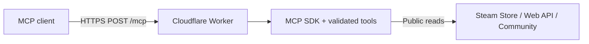

# Steam MCP

[简体中文](README.zh-CN.md) · [MIT license](LICENSE)

Look up a Steam game, compare its regional store offer, and check how many people are playing it. The hosted connector also reads game news and public Steam Community profile fields.

## Connect your Steam account

Add the **account URL** as a Streamable HTTP server. The client opens a consent page that identifies the requesting app, then Steam confirms your identity. The personal tools use the SteamID returned by Steam. Keep your password and Steam Guard code on Steam's own sign-in page.

```text
https://steam-mcp.oratisoratisoratisoratis.workers.dev/account/mcp
```

| Client | Command |
| --- | --- |
| Codex | `codex mcp add steam-personal --url https://steam-mcp.oratisoratisoratisoratis.workers.dev/account/mcp` |
| Claude Code | `claude mcp add --transport http --scope user steam-personal https://steam-mcp.oratisoratisoratisoratis.workers.dev/account/mcp` |

If your client defers sign-in, use `codex mcp login steam-personal` or choose **Authenticate** for the server in Claude Code's `/mcp`. Then ask “Which Steam account did I link, and what playtime does Steam report for the last two weeks?” For a supported game, try “Read my Left 4 Dead achievements using the community name L4D.”

| Personal tool | Hosted availability and data |
| --- | --- |
| `my_account` | Linked SteamID, visible display name, profile visibility and the two-week hours field when Steam supplies it. |
| `my_game_stats` | Per-game achievement names, returned unlock flags and reported game time from supported Steam Community stats pages. Takes the community stats name, such as `L4D` or `Portal2`. Missing fields are `null`. |
| `my_library` | Available on deployments with a server-side Steam Web API key. Returns visible owned games and available total/recent minutes per title. Disabled on the hosted deployment. |
| `my_achievements` | Available with the same key. Takes an AppID and returns visible achievement flags and available unlock timestamps. Disabled on the hosted deployment. |

**Verification on 2026-11-24.** The hosted endpoint advertises OAuth and the SDK starts authorization. Against Valve's published sample account, the account adapter read the two-week hours field and 73 *Left 4 Dead* achievement rows with unlock flags. Steam reported `0s` for this game's time. The keyless owned-games API request returned HTTP 401. Tests with a simulated Steam assertion separately exercised callback verification, PKCE token exchange, account isolation and revocation. A live user sign-in is required to verify the result for a specific player. Steam OpenID grants identity. Data visibility still follows Steam privacy settings, game support and the upstream source. Valve marks Community XML as deprecated. [Steam sign-in](https://partner.steamgames.com/doc/features/auth) · [Community data and sample](https://partner.steamgames.com/documentation/community_data) · [Owned games API](https://partner.steamgames.com/doc/webapi/IPlayerService) · [Achievements API](https://partner.steamgames.com/doc/webapi/ISteamUserStats)

**Authorization and storage.** The account endpoint uses per-client consent, S256 PKCE, a browser-bound Steam OpenID transaction and a server-to-server check with Steam. OAuth grants bind to this MCP resource. Workers KV stores client registrations, grant subjects and token records. Personal gameplay responses are fetched on demand with caching disabled. Access tokens last 30 minutes and refresh grants last up to seven days. MCP clients can revoke tokens using the advertised revocation endpoint.

To check a player account locally, run `node scripts/verify-account.mjs` and open its temporary loopback link. It prints field availability, keeps credentials in memory and revokes the verifier token when finished. The default game probe uses `Portal2`. Pass the endpoint URL and another community stats name as positional arguments to change it.

## Connect to public tools

Paste the following address into a remote MCP client and select **Streamable HTTP**. The public tools work without an API key or platform sign-in.

```text
https://steam-mcp.oratisoratisoratisoratis.workers.dev/mcp
```

**Codex**

```sh
codex mcp add steam --url https://steam-mcp.oratisoratisoratisoratis.workers.dev/mcp
```

**Claude Code**

```sh
claude mcp add --transport http --scope user steam https://steam-mcp.oratisoratisoratisoratis.workers.dev/mcp
```

Start a new conversation in Codex or open `/mcp` in Claude Code to check the connection.

## Try it

> Find Portal 2 on Steam. Show its UK price, current global player count and latest news item. Link each source.

Portal 2 resolves to AppID `620`. The agent can reuse that ID for all three follow-up calls. `country: "GB"` selects the store offer. Player counts are global.

## Tools

| Tool | Inputs | Returns |
| --- | --- | --- |
| `search_store` | `query`, `country`, `limit` | AppIDs, titles, operating systems and store links |
| `game_details` | `app_id`, `country` | Release date, publisher, OS support and formatted regional price when available |
| `current_players` | `app_id` | Global concurrent players reported by Steam |
| `game_news` | `app_id`, `limit` | Dated headlines, feed names and links |
| `public_profile` | `steam_id` | Public display name and profile visibility for a 17-digit SteamID64 |

Store text is English. The default country is `US`. Supported country codes are `US`, `GB`, `DE`, `FR`, `CA`, `AU`, `JP`, `CN`, `HK`, `TW`, `BR` and `IN`. An absent price is `null`. Check `is_free` separately. News may include external publications carried by Steam. Public profile access does not grant access to a private library, purchases or achievements.

## How requests work



Store search and details use Steam storefront endpoints. Counts and headlines use the Steam Web API. Profiles use the public Steam Community XML view. Each adapter returns the upstream identifier or citation URL. The public tools query Steam on demand.

Each request gets its own MCP server and transport. Inputs are validated before any upstream request. The Worker returns structured JSON and a text representation for clients that read text results. Platform failures are reported as tool errors. Public tools use no platform credentials. Search terms and lookup identifiers are sent to the relevant platform to complete the request.

[Steam Store](https://store.steampowered.com/) · [ISteamUserStats](https://partner.steamgames.com/doc/webapi/ISteamUserStats) · [ISteamNews](https://partner.steamgames.com/doc/webapi/ISteamNews) · [Steam Community](https://steamcommunity.com/)

## Run your own

Use Node.js 24 or later.

```sh
git clone https://github.com/oratis/steam-mcp.git
cd steam-mcp
npm ci
npm run check
npm test
npm run dev
```

In a second terminal, run the SDK smoke test. It negotiates the protocol, lists the tools and calls them against real platform data.

```sh
npm run smoke -- http://localhost:8787/mcp
```

`npm run smoke` without an argument checks the hosted service. `npm test` runs offline with fixture responses. For self-hosting, set `vars.PUBLIC_ORIGIN` to your HTTPS origin in `wrangler.jsonc`, create a Workers KV namespace and replace `kv_namespaces[0].id` with its ID. Authenticate Wrangler and run `npm run deploy`. Optionally set `npx wrangler secret put STEAM_WEB_API_KEY` to enable owned games and AppID achievements. Share `/account/mcp` with players and `/mcp` for anonymous use.

## Connection checks

- A browser GET to `/mcp` returns HTTP 405. Open the [service information](https://steam-mcp.oratisoratisoratisoratis.workers.dev/) to check the hostname, or use the smoke test for an end-to-end check.
- An upstream error after successful tool discovery concerns the platform lookup. Check the identifier and region, then retry.

Community project maintained by [oratis](https://github.com/oratis). Related connectors · [PlayStation MCP](https://github.com/oratis/playstation-mcp) · [Nintendo MCP](https://github.com/oratis/nintendo-mcp).
