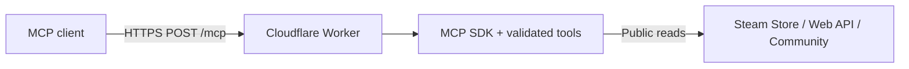

# Steam MCP

[简体中文](README.zh-CN.md) · [MIT license](LICENSE)

Look up a Steam game, compare its regional store offer, and check how many people are playing it. The hosted connector also reads game news and public Steam Community profile fields.

## Connect

Paste the following address into a remote MCP client and select **Streamable HTTP**. The public tools work without an API key or platform sign-in.

```text
https://steam-mcp.oratisoratisoratisoratis.workers.dev/mcp
```

**Codex**

```sh
codex mcp add steam --url https://steam-mcp.oratisoratisoratisoratis.workers.dev/mcp
```

**Claude Code**

```sh
claude mcp add --transport http --scope user steam https://steam-mcp.oratisoratisoratisoratis.workers.dev/mcp
```

Start a new conversation in Codex or open `/mcp` in Claude Code to check the connection.

## Try it

> Find Portal 2 on Steam. Show its UK price, current global player count and latest news item. Link each source.

Portal 2 resolves to AppID `620`. The agent can reuse that ID for all three follow-up calls. `country: "GB"` selects the store offer. Player counts are global.

## Tools

| Tool | Inputs | Returns |
| --- | --- | --- |
| `search_store` | `query`, `country`, `limit` | AppIDs, titles, operating systems and store links |
| `game_details` | `app_id`, `country` | Release date, publisher, OS support and formatted regional price when available |
| `current_players` | `app_id` | Global concurrent players reported by Steam |
| `game_news` | `app_id`, `limit` | Dated headlines, feed names and links |
| `public_profile` | `steam_id` | Public display name and profile visibility for a 17-digit SteamID64 |

Store text is English. The default country is `US`. Supported country codes are `US`, `GB`, `DE`, `FR`, `CA`, `AU`, `JP`, `CN`, `HK`, `TW`, `BR` and `IN`. An absent price is `null`. Check `is_free` separately. News may include external publications carried by Steam. Public profile access does not grant access to a private library, purchases or achievements.

## How requests work



Store search and details use Steam storefront endpoints. Counts and headlines use the Steam Web API. Profiles use the public Steam Community XML view. Each adapter returns the upstream identifier or citation URL. The hosted service queries profile visibility on demand and holds no player sessions.

Each request gets its own MCP server and transport. Inputs are validated before any upstream request. The Worker returns structured JSON and a text representation for clients that read text results. Platform failures are reported as tool errors. The service uses no account database or platform credentials. Search terms and lookup identifiers are sent to the relevant platform to complete the request.

[Steam Store](https://store.steampowered.com/) · [ISteamUserStats](https://partner.steamgames.com/doc/webapi/ISteamUserStats) · [ISteamNews](https://partner.steamgames.com/doc/webapi/ISteamNews) · [Steam Community](https://steamcommunity.com/)

## Run your own

Use Node.js 24 or later.

```sh
git clone https://github.com/oratis/steam-mcp.git
cd steam-mcp
npm ci
npm run check
npm test
npm run dev
```

In a second terminal, run the SDK smoke test. It negotiates the protocol, lists the tools and calls them against real platform data.

```sh
npm run smoke -- http://localhost:8787/mcp
```

`npm run smoke` without an argument checks the hosted service. `npm test` runs offline with fixture responses. To deploy, authenticate Wrangler with your Cloudflare account and run `npm run deploy`. Give clients the deployed Worker URL with `/mcp` appended.

## Connection checks

- A browser GET to `/mcp` returns HTTP 405. Open the [service information](https://steam-mcp.oratisoratisoratisoratis.workers.dev/) to check the hostname, or use the smoke test for an end-to-end check.
- An upstream error after successful tool discovery concerns the platform lookup. Check the identifier and region, then retry.

Community project maintained by [oratis](https://github.com/oratis). Related connectors · [PlayStation MCP](https://github.com/oratis/playstation-mcp) · [Nintendo MCP](https://github.com/oratis/nintendo-mcp).
